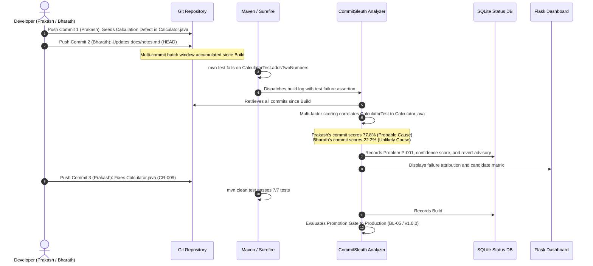

# CommitSleuth — Intelligent CI Build Failure Attribution System

[](https://www.python.org/)
[](https://maven.apache.org/)
[](https://www.jenkins.io/)
[](https://flask.palletsprojects.com/)
[](https://www.sqlite.org/)
[]()
[]()

> **Course:** ISWE403L — Software Configuration Management (SCM)  
> **Review:** SCM Final Review — Tool Implementation (Review-III)  
> **Institution:** School of Computer Science Engineering and Information Systems (SCOPE), Vellore Institute of Technology (VIT), Vellore  
> **Team Members:**  
> * **Bharathwaraj K S** — Register No: **23MIS0070**  
> * **Prakash Raj U** — Register No: **23MIS0180**  
> **Repository:** [https://github.com/prakashumapathi07-spec/COMMITSLEUTHSCM.git](https://github.com/prakashumapathi07-spec/COMMITSLEUTHSCM.git)

---

## 📖 Overview

**CommitSleuth** is an intelligent build failure attribution and Software Configuration Management (SCM) automation platform designed for modern continuous integration pipelines.

When developer commit velocity is high, multiple commits accumulate between continuous integration builds—a challenge known as the **batching problem**. Conventional CI engines simply mark the pipeline as failed, forcing engineers to fall back on an unreliable "blame the latest commit" heuristic.

CommitSleuth resolves this by:
1. Monitoring Jenkins and Maven/Surefire execution output.
2. Intercepting compilation, dependency, or unit test failures.
3. Analyzing the complete range of candidate commits introduced since the last successful baseline.
4. Calculating multi-factor, normalized confidence scores based on affected source files, test-to-source mapping, dependency changes in `pom.xml`, recency, and changeset size.
5. Formulating transparent, explainable evidence and safety-checked rollback recommendations (`git revert <hash>`).
6. Enforcing SCM quality gates for promotion between Development, Testing, and Production baselines.

---

## 🛠️ Toolchain and SCM Integration

| Tool | Role in CommitSleuth | SCM Activity Supported |
|---|---|---|
| **Git & GitHub** | Version control, branching (`main`, `develop`, `bugfix/*`, `feature/*`), tags (`v0.1.0`, `v0.2.0`, `v1.0.0`), commit-msg hooks | Version Management & Baseline Control |
| **Jenkins** | Automated declarative CI pipeline execution on commit/push | Continuous Integration & Automated Verification |
| **Apache Maven** | Java application compilation, JUnit 5 Surefire test runner, dependency management | Build Automation & Dependency Control |
| **Python 3** | Build log parsing, commit scoring heuristic engine, status reporter, release manager | Failure Attribution & SCM Automation |
| **SQLite3** | Central relational database storing builds, candidate scores, problems, CRs, baselines, and audit observations | Configuration Status Accounting (CSA) |
| **Flask** | Modern, responsive executive web dashboard with Role-Based Access Control | Web Enabling & Management Portal |

---

## 🚀 Quickstart Guide

### 1. Prerequisites
Ensure the following tools are installed on your machine:
* **Python 3.10+** (with pip)
* **Java SE JDK 17+**
* **Apache Maven 3.8+**
* **Git 2.40+**

### 2. Clone and Setup
```powershell
# Clone the repository
git clone https://github.com/prakashumapathi07-spec/COMMITSLEUTHSCM.git
cd COMMITSLEUTHSCM

# Install Python dependencies
pip install -r requirements.txt

# Initialize and seed the SQLite SCM database
python database/seed.py --reset
```

### 3. Run Automated Tests
```powershell
# Execute Python SCM test suite (17 tests)
pytest tests/

# Execute Java Maven test suite (7 tests)
mvn -B -f maven/pom.xml test
```

### 4. Launch the Web Portal
```powershell
python dashboard/app.py
```
Open your browser and navigate to: **[http://127.0.0.1:5000](http://127.0.0.1:5000)**

#### Demonstration Credentials:
* **Administrator:** `prakash` / `admin123`
* **Administrator:** `bharath` / `admin123`
* **Auditor / Viewer:** `viewer` / `viewer123`

---

## 🧪 Reproducing the End-to-End Scenario

CommitSleuth includes a realistic, repeatable demonstration proving how it overcomes the batching problem.



### Execution Steps:
1. **Record Baseline Passing Build #101:**
   ```powershell
   python analyzer/record_build.py --result SUCCESS --build 101 --branch develop
   ```
2. **Switch to Demonstration Branch with Seeded Batch:**
   ```powershell
   git checkout bugfix/demo-calc-failure
   ```
3. **Trigger Build Failure & Capture Output:**
   ```powershell
   mvn -B -f maven/pom.xml test > build.log 2>&1
   ```
4. **Run CommitSleuth Attribution Analyzer:**
   ```powershell
   python analyzer/record_build.py --result FAILURE --build 102 --log build.log --branch bugfix/demo-calc-failure
   ```
   *Output demonstrates:*
   `NOTIFY: Build #102 FAILED (test). Suspect commit 9297e33 by Prakash Raj U, confidence 0.778. Action: Rollback recommended: git revert 9297e33`
5. **Verify Defect Resolution & Passing Build #103:**
   ```powershell
   git checkout main
   mvn -B -f maven/pom.xml test
   python analyzer/record_build.py --result SUCCESS --build 103 --branch main
   ```
6. **Evaluate SCM Promotion Gate:**
   ```powershell
   python analyzer/promote.py --item "CommitSleuth Suite" --from Testing --to Production --approver "CCB" --tests-passed --cr CR-009 --tag v1.0.0
   ```
7. **Generate Cryptographic Release Manifest:**
   ```powershell
   python analyzer/release_manager.py
   ```

---

## 📊 Summary of SCM Final Review Activities

| No. | SCM Activity | Implemented Solution | Verification Location |
|---|---|---|---|
| **1** | **Tool Implementation** | Git/GitHub, Jenkins, Maven, Python, Flask, SQLite | Working end-to-end toolchain |
| **2** | **Version Management** | Branching model (`main`, `develop`, `bugfix/*`), tags (`v0.1.0`, `v0.2.0`, `v1.0.0`), commit-msg hook | Git history, `/baselines` |
| **3** | **Change Management** | Formal CR register (CR-001..CR-009), impact assessment, CCB approval transitions | `/crs` |
| **4** | **Problem Tracking** | Defect tracking (P-001), candidate commit ranking, 5-stage lifecycle (`Open` $\rightarrow$ `Closed`) | `/problems`, `/problem/<id>` |
| **5** | **Promotional Management** | SCM promotion quality gates, blocked vs passed records, CCB approval verification | `/promotions`, `promote.py` |
| **6** | **System Accounting** | 20 CIs registered, CSAR report generator, dynamic CSV export | `/report`, `/report/csv` |
| **7** | **CAS (Auditing)** | Functional Configuration Audit (FCA) & Physical Configuration Audit (PCA) checklists, observations AO-01..07 | `/audits` |
| **8** | **Access and Security** | Role-Based Access Control (Admin, Maintainer, Viewer), password hashing, audit trail | `/audit-trail`, `/login` |
| **9** | **Customization** | Configurable attribution weights and rollback thresholds via YAML and live UI editor | `/config`, `scoring_config.yaml` |
| **10** | **Web Enabling** | Executive dark-mode responsive dashboard with 11 views | Flask app on port 5000 |

---

## 📁 Repository Structure

```text
COMMITSLEUTHSCM/
├── analyzer/
│   ├── common.py             # Database connectivity, configuration, audit logging
│   ├── log_parser.py         # Maven compiler and Surefire test log parser
│   ├── promote.py            # SCM quality promotion gate evaluator
│   ├── record_build.py       # Jenkins post-build agent & failure attribution trigger
│   ├── release_manager.py    # Cryptographic SHA-256 release manifest generator
│   ├── scorer.py             # Multi-factor commit ranking and rollback advisor
│   └── status_reporter.py    # CSAR status report generator and CSV exporter
├── dashboard/
│   └── app.py                # Full-featured Flask web portal (11 routes)
├── database/
│   ├── schema.sql            # Relational SQLite schema (11 tables)
│   └── seed.py               # Database initialization and seeder
├── docs/
│   ├── SCM_Final_Review_Tool_Implementation.md  # Comprehensive Final Review Report
│   └── screenshots/          # 13 genuine screenshots from operational system
├── hooks/
│   └── commit-msg            # Git commit message policy enforcement hook
├── jenkins/
│   └── Jenkinsfile           # Declarative Jenkins CI pipeline definition
├── maven/
│   ├── pom.xml               # Maven configuration with JUnit 5 and Surefire
│   └── src/                  # Java demonstration application (Calculator & Validator)
├── reports/                  # Generated CSAR reports, release manifests, CSV files
├── tests/
│   ├── test_dashboard.py     # Integration tests for Flask routes and RBAC
│   ├── test_log_parser.py    # Unit tests for Maven log parsing
│   ├── test_promote.py       # Unit tests for SCM promotion gates
│   └── test_scorer.py        # Unit tests for attribution ranking heuristics
├── .gitignore
├── README.md
├── requirements.txt          # Python dependencies
└── scoring_config.yaml       # Configurable attribution weights and thresholds
```

---

## 👥 Authors and Acknowledgments
Developed by **Bharathwaraj K S (23MIS0070)** and **Prakash Raj U (23MIS0180)** for course **ISWE403L — Software Configuration Management** at **Vellore Institute of Technology (VIT), Vellore**.
