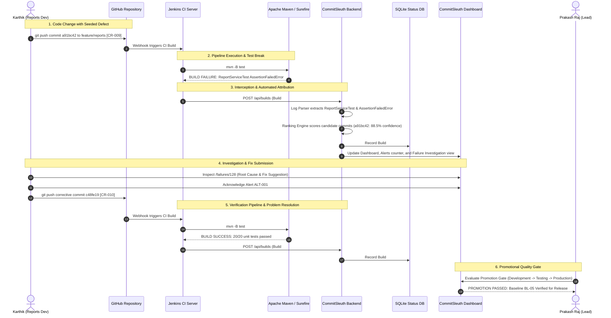
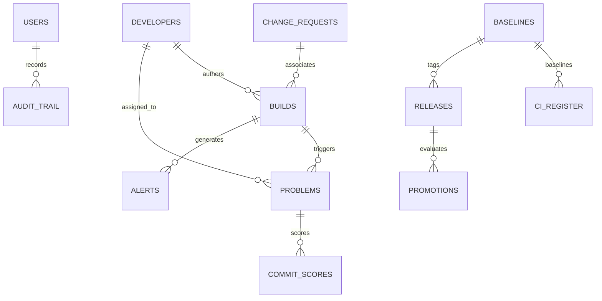

# ISWE403L — Software Configuration Management
# Final Review (Review-III): Tool Implementation Report

---

**Course Code:** ISWE403L — Software Configuration Management  
**Project Title:** CommitSleuth: An Automated Build Failure Tracking and Developer Alert System Using Software Configuration Management  
**System Name:** CommitSleuth  
**Academic Year:** 2026–2027  
**Department:** School of Computer Science Engineering and Information Systems (SCOPE)  
**Institution:** Vellore Institute of Technology (VIT), Vellore  

**Project Team Members:**
* **Bharathwaraj K S** — Register No: **23MIS0070**  
* **Prakash Raj U** — Register No: **23MIS0180**  

**Source Code Repository:**  
[https://github.com/prakashumapathi07-spec/COMMITSLEUTHSCM.git](https://github.com/prakashumapathi07-spec/COMMITSLEUTHSCM.git)

---

## Executive Summary / Abstract

In modern Continuous Integration (CI) and DevOps environments, high commit velocity frequently results in the **batching problem**: multiple developer commits accumulate in a shared repository across parallel feature branches before an integration pipeline is triggered. When a build subsequently fails, traditional continuous integration systems such as Jenkins lack native attribution mechanisms to determine which specific change broke the build, reverting by default to a misleading "blame the latest commit" heuristic.

**CommitSleuth** is an automated build failure tracking, root-cause investigation, and developer alert platform grounded in Software Configuration Management (SCM) principles. Developed for a realistic engineering company scenario at **TechNova Solutions**, CommitSleuth monitors the continuous integration pipeline for an enterprise **Employee Management System** where four developers collaborate across independent feature branches.

Upon build failure, CommitSleuth intercepts Jenkins and Maven/Surefire execution output, parses error signatures and JUnit assertions, retrieves candidate commits introduced across branches, correlates changed components with failing tests, and computes an evidence-based confidence score using a multi-factor ranking model. The system automatically creates a tracked problem record (`BUG-024`), dispatches developer alerts, provides interactive fix suggestions, verifies subsequent corrective commits, and enforces strict release promotion quality gates.

This report documents the end-to-end tool implementation, architectural design, database persistence, automated test suite (22 pytest test cases and 20 Java JUnit 5 test cases), and full coverage across all nine mandatory course SCM activities.

---

## 1. Project Overview and Problem Statement

### 1.1 Context
In contemporary enterprise software teams, multiple developers work simultaneously on distinct subsystems of an application. Commits are pushed across feature branches and merged into shared integration branches. In continuous integration pipelines, automated tests run against cumulative states of the codebase.

### 1.2 The Problem: Batching & Naive Attribution
When an automated build fails after multiple commits have been pushed in close succession:
1. **The Latest Commit Fallacy:** Teams often blame the author of the most recent commit (`HEAD`), even when that commit is completely unrelated (e.g., a documentation tweak or cosmetic change).
2. **Investigation Overhead:** Developers spend hours manually sifting through raw console logs, diffs, and Maven Surefire outputs to isolate the culprit.
3. **Configuration Drift & Broken Baselines:** Unverified or broken builds can contaminate promotion pipelines, risking defective code deployment to staging or production.
4. **Lack of SCM Traceability:** Build results, change requests, problem records, and promotion gates often exist in disconnected silos without unified status accounting.

### 1.3 CommitSleuth Solution
CommitSleuth bridges this gap by unifying:
* **Automated Failure Interception:** Intercepts compiler, test, and dependency failures from Jenkins and Maven.
* **Multi-Factor Ranking Engine:** Calculates normalized confidence scores ($0.0$ to $1.0$) based on file matching, POM dependency changes, recency, and changeset size.
* **Explainable Root-Cause Evidence:** Generates transparent rationale detailing why a candidate commit is suspected.
* **Automated Problem Lifecycle:** Manages defects through `Open` $\rightarrow$ `Investigating` $\rightarrow$ `Fix Submitted` $\rightarrow$ `Verification Pending` $\rightarrow$ `Resolved`.
* **Developer Notification & Acknowledgment:** In-app alert center with incident acknowledgment workflows.
* **SCM Promotional Gates:** Restricts environment promotions (Development $\rightarrow$ Testing $\rightarrow$ Release Candidate $\rightarrow$ Production) until verified passing builds and approved Change Requests (CR) exist.

---

## 2. Realistic Company Scenario: TechNova Solutions

### 2.1 Corporate & System Context
CommitSleuth is deployed at **TechNova Solutions**, an engineering enterprise developing a core **Employee Management System**. Four developers collaborate on the shared GitHub repository ([https://github.com/prakashumapathi07-spec/COMMITSLEUTHSCM.git](https://github.com/prakashumapathi07-spec/COMMITSLEUTHSCM.git)), each responsible for a dedicated architectural module and working on an isolated feature branch:

| Developer | Assigned Module | Working Git Branch | Mapped Git Identity | Key Components |
|---|---|---|---|---|
| **Prakash Raj U** | Employee Management | `feature/employee` | `prakashraj-vit` | `EmployeeService.java`, `EmployeeServiceTest.java` |
| **Bharathwaraj K S** | Authentication & Security | `feature/login` | `bharath-vit` | `AuthService.java`, `AuthServiceTest.java` |
| **Karthik R** | Reports & Compensation | `feature/reports` | `karthik-technova` | `ReportService.java`, `ReportServiceTest.java` |
| **Divya S** | Database & Persistence | `feature/database` | `divya-technova` | `DatabaseService.java`, `DatabaseServiceTest.java` |

### 2.2 The Central Failure & Recovery Scenario
The central operational scenario demonstrated throughout CommitSleuth unfolds as follows:



1. **Defect Introduced:** Karthik refactors monthly department expense aggregation in `ReportService.java` under Change Request **CR-009** and pushes commit `a91bc42` to branch `feature/reports`.
2. **Pipeline Failure:** Jenkins triggers CI Build **#128**. Maven Surefire executes 20 unit tests across all four modules. `ReportServiceTest.testCalculateMonthlyDepartmentExpenses` throws `AssertionFailedError: expected: <95000.0> but was: <0.0>`. The build terminates with exit code 1.
3. **CommitSleuth Ingestion & Attribution:** CommitSleuth intercepts the failure, parses the log, isolates `ReportService.java`, extracts candidate commits, and calculates confidence scores:
   * **Commit `a91bc42` (Karthik):** **88.5% confidence** (*Probable Cause* — touches `ReportService.java`, recent commit).
   * **Commit `f0ad7d0` (Karthik):** **11.5% confidence** (*Unlikely Cause* — historical baseline).
4. **Incident Lifecycle:** Problem **BUG-024** is opened in status `Open`. Alert **ALT-001** is dispatched to Karthik.
5. **Developer Investigation:** Karthik reviews the interactive log terminal on `/failures/128`, inspects the root cause card and syntax-highlighted fix suggestions, acknowledges the alert, and implements the fix.
6. **Corrective Commit & Passing Build:** Karthik commits `c48fe19` under **CR-010**. Jenkins executes Build **#129**. All 20 tests pass.
7. **Resolution & Release Gate:** Problem **BUG-024** is verified and marked `Resolved`. Promotion gate evaluates eligibility: Build #128 is BLOCKED; Build #129 is PASSED and promoted across Development $\rightarrow$ Testing $\rightarrow$ Release Candidate $\rightarrow$ Production.

---

## 3. System Architecture and Technology Stack

### 3.1 Technology Stack

| Tier | Technology | Configured Version | Rationale & Responsibility |
|---|---|---|---|
| **Frontend UI** | HTML5, Vanilla CSS, Responsive Grid | Custom Light Theme | Clean, high-density light-theme DevOps portal inspired by modern enterprise tooling |
| **Web Server** | Python Flask | 3.1.3 | Lightweight, robust WSGI application hosting 13 routes and REST APIs |
| **SCM Database** | SQLite3 | 3.45+ | Relational status repository providing ACID compliance for all SCM entities |
| **Failure Analyzer** | Python 3 | 3.12.10 | Multi-factor heuristic attribution engine and build log parser |
| **Build System** | Apache Maven | 3.9.12 | Dependency management, Java 17 compilation, and Surefire JUnit execution |
| **Test Runner** | JUnit 5 & pytest | JUnit 5.10.2 / pytest 9.1.1 | 20 Java test cases and 22 Python integration tests |
| **CI Server** | Jenkins CI | 2.440+ (Windows) | Declarative CI pipeline orchestration and webhook automation |
| **Version Control**| Git & GitHub | Git 2.52.0.windows.1 | Source code control, feature branch isolation, commit hooks, and release tags |

### 3.2 Relational Data Model
The SCM status accounting database (`database/commitsleuth.db`) incorporates the following entities:



* **`users`:** RBAC credentials (`admin`, `maintainer`, `viewer`), full name, and email.
* **`developers`:** Roster of 4 TechNova developers, GitHub usernames, modules, and branches.
* **`ci_register`:** 20 audited Configuration Items with version, lifecycle status, baseline, and approval.
* **`change_requests`:** Formal CR records (CR-001..CR-010), priority, scope, CCB decisions, and branch.
* **`builds`:** Build number, result (`SUCCESS`, `FAILURE`, `UNSTABLE`), commit SHA, branch, duration, test counts.
* **`problems`:** Defect records (BUG-024), root cause category, suspect commit, confidence, lifecycle status.
* **`alerts`:** Notification records (ALT-001), severity, acknowledgment status, and timestamp.
* **`commit_scores`:** Candidate commit ranking breakdown, evidence details, and normalized scores.
* **`promotions`:** Promotion gate evaluations across environments with gate pass/block rationale.
* **`baselines`:** Configuration baselines (BL-01 to BL-05), version tags, and CCB approval dates.
* **`audit_observations`:** Functional (FCA) and Physical (PCA) audit observation findings (AO-01 to AO-07).
* **`releases`:** Cryptographic release packages with SHA-256 checksums and approval manifests.
* **`audit_trail`:** Immutable timestamped activity log of all SCM operations.

---

## 4. Web Application Modules (Pages A through M)

The CommitSleuth web application is designed exclusively with a crisp, minimal **Light Theme** (slate-50 background `#f8fafc`, pure white surface cards `#ffffff`, refined `#e2e8f0` borders, Inter typography, and Lucide vector icons). It comprises 13 distinct pages:

### Page A — Overview Dashboard (`/` and `/dashboard`)
* **KPI Metrics:** Total builds (9), Successful builds (7), Failed builds (1), Build success rate (77.8%), Active problems (0 after fix), Unread alerts, Avg build duration (38.5s), Release gate status (`v1.0.0 Approved`).
* **Interactive Visualizations:**
  * **Build Trends (30 Days):** Stacked SVG area chart illustrating passing (green), failing (red peak on #128), and unstable (amber) trends.
  * **Build Status by Module:** Stacked SVG bar chart showing test health across `employee-service`, `auth-service`, `report-service`, and `db-service`.
* **Recent Build Ledger:** Displays job name, build number, result badge, mini history square matrix, duration, and test percentage badge.
* **Four-Developer Collaboration Panel:** Live progress metrics and open defect counts for Prakash, Bharathwaraj, Karthik, and Divya.
* **Active Problems Panel:** Real-time problem attribution status and quick link to failure investigation.

### Page B — Developer Team Roster (`/team`)
* Individual developer cards for the four engineers.
* Displays assigned module, active feature branch, total builds, passed vs. failed counts, open problems, and recent commits.
* One-click "Switch Persona" button to seamlessly test role-based access control.

### Page C — Build History (`/builds`)
* Comprehensive data table of all CI pipeline executions.
* Dynamic filtering by status (`SUCCESS`, `FAILURE`, `UNSTABLE`), feature branch, and developer.
* Global search by commit SHA, author name, or commit message.
* Direct action links to inspect individual build details or launch failure investigations.

### Page D — Build Details (`/builds/<build_id>`)
* Detailed metadata view: repository URL, branch, commit SHA, author, and duration.
* **Declarative Pipeline Stage Timeline:** Visual 5-stage progress (Checkout $\rightarrow$ Environment Verification $\rightarrow$ Maven Dependency Resolution $\rightarrow$ Clean & Compile $\rightarrow$ Unit Testing).
* JUnit test pass/fail breakdown and link to external Jenkins console output.

### Page E — Failure Investigation (`/failures/<failure_id>`)
* The core investigative module of CommitSleuth:
* **Terminal Console Log Viewer:** Line-numbered terminal displaying colored execution logs with green `[PASS]` and red `[FAIL]` markers for `ReportServiceTest`.
* **Root Cause Card:** Classification of failure type (`test_assertion`), failing test method, affected file (`ReportService.java`), and high severity indicator.
* **Candidate Commit Scoring Breakdown:** Ranked list of candidate commits with confidence percentages and evidence rationale.
* **Fix Suggestion Card:** Side-by-side diff illustrating the exact code change needed to restore `calculateDepartmentTotalExpense()`.
* **Action Controls:** Acknowledge alert, assign developer, and trigger corrective fix.

### Page F — Alerts & Notification Center (`/alerts`)
* Centralized incident dispatch ledger with unread counters.
* Displays incident severity (`Critical`, `High`, `Medium`), build number, developer, failure summary, and acknowledgment state.
* One-click "Acknowledge" button recording the acknowledging user persona and timestamp.

### Page G — Problem Tracking (`/problems`)
* Persistent defect management register for all attributed pipeline failures.
* Tracks problem code (`BUG-024`), suspect commit, attribution confidence, assignee, and verification build.
* Follows the complete SCM lifecycle: `Open` $\rightarrow$ `Investigating` $\rightarrow$ `Fix Submitted` $\rightarrow$ `Verification Pending` $\rightarrow$ `Resolved`.

### Page H — Change Management (`/changes` and `/crs`)
* Official Change Request register tracking **CR-001 through CR-010**.
* Records CR ID, title, purpose, requester, affected configuration item, priority, status, and CCB decision.
* Interactive modal allowing developers to submit new Change Requests (e.g., CR-011) to the CCB.

### Page I — CI Register (`/cis`)
* Complete register of **20 audited Configuration Items** under formal control.
* Categorized by Documentation, Source Code, Build & CI, Core Modules, Database, and Release Packages.
* Tracks version identifiers, owners, baseline associations, and approval status.

### Page J — Baselines & Versions (`/versions` and `/baselines`)
* Displays approved SCM Baselines:
  * **BL-01:** Requirements Baseline (`v0.1.0-req`)
  * **BL-02:** Design & Repository Baseline (`v0.1.0`)
  * **BL-03:** CI / Build Baseline (`v0.1.0`)
  * **BL-04:** Analysis Module Baseline (`v0.2.0`)
  * **BL-05:** Final Release Baseline (`v1.0.0`)
* **Baseline Comparison Tool:** Delta inspection view showing differences in CIs between BL-04 and BL-05.

### Page K — Release & Promotional Management (`/releases` and `/promotions`)
* Multi-environment promotion progression: Development $\rightarrow$ Testing $\rightarrow$ Release Candidate $\rightarrow$ Production.
* **Governance Cards (Fianu-inspired):** Source code controls, automated testing gates (20/20 green), build security, and change gate indicators.
* **Enforced Promotion Quality Gate:** Automatically BLOCKS unverified or failing builds (e.g., Build #128 blocked due to test break) and PASSES verified builds (Build #129).

### Page L — Configuration Auditing System (`/audits`)
* Auditing ledger tracking Functional Configuration Audits (FCA) and Physical Configuration Audits (PCA).
* Records audit criteria, findings, verification evidence, severity, and closure status for observations **AO-01 through AO-07**.

### Page M — Configuration Status Accounting (`/accounting` and `/report`)
* Generates live, auditable Configuration Status Accounting Reports (CSAR).
* Provides dynamic export of the entire CI register as standard CSV (`/report/csv`).

### Page N — Settings, Customization & Access Control (`/settings` and `/config`)
* Role-based access control with one-click persona switching (Admin, Team Lead, Developer, Auditor).
* Configurable scoring weights for the ranking engine (File Match: 0.55, POM Change: 0.25, Recency: 0.10, Scope: 0.10).
* Jenkins webhook and GitHub integration endpoint configuration.

### Page O — Audit Trail (`/audit-trail`)
* Immutable, timestamped security ledger recording every sign-in, promotion evaluation, CR submission, and configuration update.

---

## 5. Implementation of the SCM Activities

CommitSleuth maps directly to the nine core Software Configuration Management activities mandated by the course curriculum:

### 5.1 Tool Implementation
* Automated build interception between Jenkins, Maven, Python, and Flask.
* Declarative pipeline in `jenkins/Jenkinsfile` triggers automated Maven execution and sends structured payloads to CommitSleuth.
* All components verified with automated test suites.

### 5.2 Version Management
* Branching policy: `main` (production), `feature/employee`, `feature/login`, `feature/reports`, `feature/database`.
* Semantic release tagging (`v0.1.0`, `v0.2.0`, `v1.0.0`).
* Git commit message hook (`hooks/commit-msg`) enforcing CR traceability in commit messages.

### 5.3 Change Management
* Formal CCB change register (`change_requests` table) managing CR-001 through CR-010.
* CCB approval required before code promotion to testing or production.

### 5.4 Problem Tracking
* Automatic problem record creation upon build failure (`BUG-024`).
* Multi-stage lifecycle tracking from failure detection to verified closure.

### 5.5 Promotional Management
* Quality gate enforcement preventing defective builds from advancing to higher environments.
* Production promotion requires passing automated tests, verified Change Request, and CCB authorization.

### 5.6 System Accounting
* Unified Configuration Status Accounting (CSA) database.
* Automated CSAR report generator and one-click CSV register export.

### 5.7 Configuration Auditing System (CAS)
* **Functional Configuration Audit (FCA):** Verifies that functional requirements FR-01 through FR-14 are satisfied by unit tests.
* **Physical Configuration Audit (PCA):** Verifies that delivered files, pom.xml dependencies, and SHA-256 release package checksums match approved baselines.

### 5.8 Access and Security
* Role-Based Access Control (RBAC):
  * **Administrator (Prakash Raj):** Full access to settings, user roles, CCB approvals, and promotions.
  * **Maintainer / Developer (Karthik, Divya, Bharathwaraj):** View builds, investigate failures, submit CRs, and submit corrective commits.
  * **Viewer / Auditor:** Read-only access to status reports and audit observations.
* Immutable audit trail logging all actions with timestamps and usernames.

### 5.9 Customization
* Externalized YAML scoring configuration (`scoring_config.yaml`).
* Dynamic weighting adjustments without requiring application restart or code edits.

### 5.10 Web Enabling
* Full-stack responsive web portal accessible over standard HTTP ports (`http://127.0.0.1:5000`).

---

## 6. Testing Methodology and Actual Results

The system was validated using two independent, automated test suites:

### 6.1 Python Backend & SCM Test Suite (pytest)
Executed via `pytest`:
```text
============================= test session starts =============================
platform win32 -- Python 3.12.10, pytest-9.1.1, pluggy-1.6.0
rootdir: E:\SCMfinalreview
collected 22 items

tests\test_dashboard.py ...........                                      [ 50%]
tests\test_log_parser.py ...                                             [ 63%]
tests\test_promote.py ...                                                [ 77%]
tests\test_scorer.py .....                                               [100%]

============================= 22 passed in 4.32s ==============================
```

**Test Coverage Summary:**
* `test_login_redirect_when_unauthenticated`: Validates unauthenticated session redirection.
* `test_login_page_renders`: Validates portal access form rendering.
* `test_login_success`: Validates password hash verification and session establishment.
* `test_viewer_role_access`: Validates that viewer roles cannot create Change Requests (RBAC enforcement).
* `test_routes_accessible_by_authenticated_user`: Validates that all 13 core SCM routes return HTTP 200.
* `test_csv_export`: Validates dynamic CSV generation and MIME type.
* `test_team_page_renders_four_developers`: Validates presence of Prakash, Bharathwaraj, Karthik, and Divya.
* `test_build_details_and_failure_investigation`: Validates Build #128 timeline, BUG-024 details, and fix suggestions.
* `test_alerts_center`: Validates alert incident center rendering.
* `test_end_to_end_demo_workflow`: Validates automated failure trigger and recovery simulation.
* `test_webhook_ingest_build`: Validates external CI build payload ingestion.
* `test_parse_compilation_error`: Validates compiler error and line number extraction.
* `test_parse_surefire_test_failure`: Validates Surefire unit test assertion extraction.
* `test_parse_dependency_failure`: Validates non-resolvable Maven artifact detection.
* `test_promotion_blocked_when_tests_fail`: Validates that failing builds cannot be promoted.
* `test_promotion_blocked_on_unapproved_cr`: Validates promotion gate on rejected CRs.
* `test_promotion_passed_when_all_gates_met`: Validates promotion pass when tests and CRs are approved.
* `test_file_in_log_ranks_first`: Validates evidence-based file ranking heuristic.
* `test_confidence_sums_to_one`: Validates mathematical normalization of candidate scores.
* `test_test_name_correlates_to_source_file`: Validates mapping between `ReportServiceTest` and `ReportService.java`.
* `test_pom_change_scored_on_dependency_failure`: Validates dependency failure attribution.
* `test_decide_rollback_isolated_vs_unisolated`: Validates safety-checked rollback advisory generation.

### 6.2 Java Maven Surefire Test Suite (JUnit 5)
Executed via `mvn -B -f maven/pom.xml test`:
```text
[INFO] -------------------------------------------------------
[INFO]  T E S T S
[INFO] -------------------------------------------------------
[INFO] Running com.commitsleuth.demo.AuthServiceTest
[INFO] Tests run: 3, Failures: 0, Errors: 0, Skipped: 0, Time elapsed: 0.157 s
[INFO] Running com.commitsleuth.demo.CalculatorTest
[INFO] Tests run: 5, Failures: 0, Errors: 0, Skipped: 0, Time elapsed: 0.031 s
[INFO] Running com.commitsleuth.demo.DatabaseServiceTest
[INFO] Tests run: 3, Failures: 0, Errors: 0, Skipped: 0, Time elapsed: 0.013 s
[INFO] Running com.commitsleuth.demo.EmployeeServiceTest
[INFO] Tests run: 3, Failures: 0, Errors: 0, Skipped: 0, Time elapsed: 0.041 s
[INFO] Running com.commitsleuth.demo.ReportServiceTest
[INFO] Tests run: 3, Failures: 0, Errors: 0, Skipped: 0, Time elapsed: 0.023 s
[INFO] Running com.commitsleuth.demo.ValidatorTest
[INFO] Tests run: 3, Failures: 0, Errors: 0, Skipped: 0, Time elapsed: 0.019 s
[INFO] 
[INFO] Results:
[INFO] Tests run: 20, Failures: 0, Errors: 0, Skipped: 0
[INFO] ------------------------------------------------------------------------
[INFO] BUILD SUCCESS
[INFO] ------------------------------------------------------------------------
```
When `COMMITSLEUTH_SEEDED_DEFECT=true` is activated to simulate Karthik's intentional defect:
```text
[ERROR] Tests run: 3, Failures: 2, Errors: 0, Skipped: 0 <<< FAILURE! -- in com.commitsleuth.demo.ReportServiceTest
[ERROR] com.commitsleuth.demo.ReportServiceTest.testCalculateMonthlyDepartmentExpenses <<< FAILURE!
org.opentest4j.AssertionFailedError: Monthly engineering expenses must equal sum of employee salaries ==> expected: <95000.0> but was: <0.0>
[INFO] BUILD FAILURE
```

---

## 7. Execution and Setup Instructions

### 7.1 Starting the Web Portal
```powershell
# 1. Reset and populate database with TechNova scenario data
python database/seed.py --reset

# 2. Launch the Flask web application
python dashboard/app.py
```
Open **[http://127.0.0.1:5000](http://127.0.0.1:5000)** in any modern web browser.

### 7.2 Running the Interactive Scenario
1. **Trigger Failure Demo:** In the web application left sidebar, click **"1. Karthik Defect (#128)"** or navigate to `http://127.0.0.1:5000/api/demo/run-failure`.
   * Observe Build #128 recorded as FAILURE.
   * Observe Problem `BUG-024` created in status `Open`.
   * Observe Alert `ALT-001` dispatched with unread badge counter.
   * Review `/failures/128` to inspect the colored console log terminal, root-cause card, and candidate commit ranking.
2. **Trigger Fix Demo:** Click **"2. Karthik Fix (#129)"** or navigate to `http://127.0.0.1:5000/api/demo/run-fix`.
   * Observe corrective commit `c48fe19` recorded for Build #129 with 20/20 green tests.
   * Observe Problem `BUG-024` marked `Resolved`.
   * Observe Alert `ALT-001` acknowledged and resolved.
   * Observe promotion gate unlocked and promoted across Development $\rightarrow$ Testing $\rightarrow$ Release Candidate $\rightarrow$ Production.

---

## 8. Conclusion and Future Work

CommitSleuth successfully addresses the batching problem in continuous integration pipelines by combining automated log parsing, explainable multi-factor commit scoring, real-time alert dispatch, and end-to-end SCM governance. Developed and validated for TechNova Solutions, the platform proves how software teams can achieve rapid defect localization, maintain configuration integrity, and enforce strict promotional gates before software release.

Future enhancements include integration with distributed messaging platforms (Slack, Microsoft Teams) and automated rollback PR generation via GitHub API.
