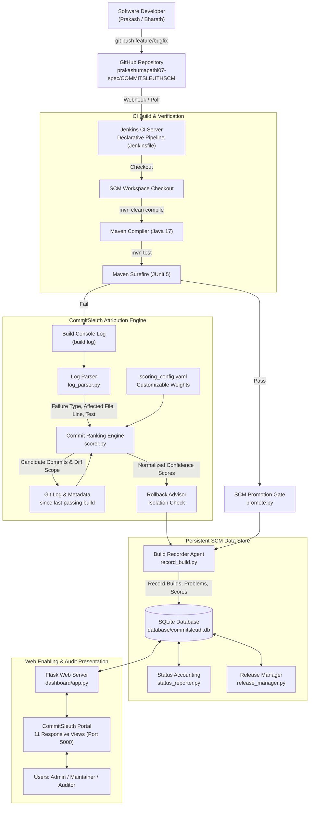
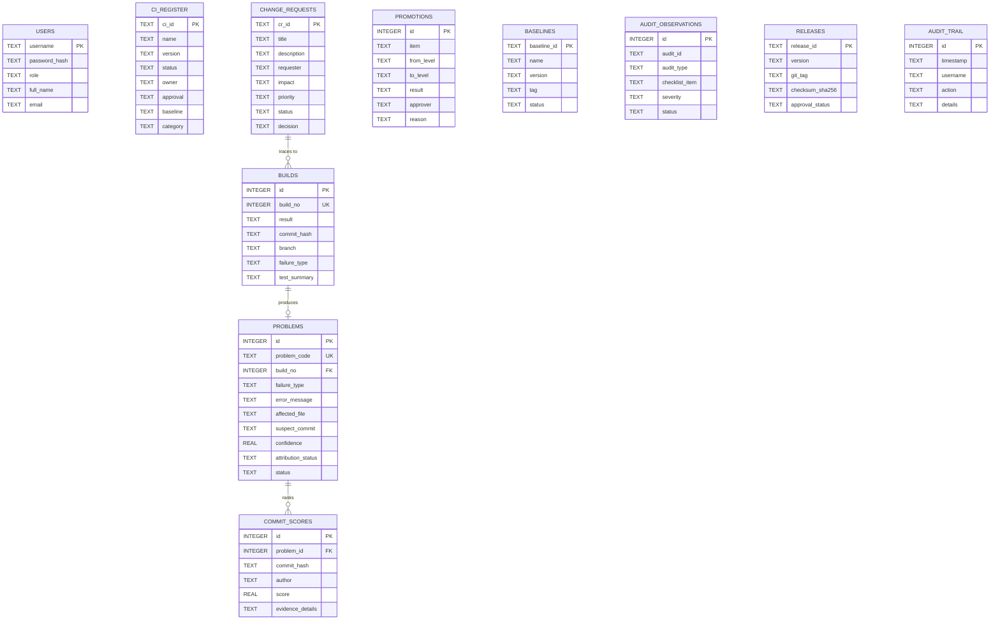

# ISWE403L — Software Configuration Management
# Final Review (Review-III): Tool Implementation Report

---

**Course Code:** ISWE403L — Software Configuration Management  
**Project Title:** An Intelligent Build Failure Attribution System for Continuous Integration Pipelines Using Software Configuration Management  
**System Name:** CommitSleuth  
**Academic Year:** 2026–2027  
**Department:** School of Computer Science Engineering and Information Systems (SCOPE)  
**Institution:** Vellore Institute of Technology (VIT), Vellore  

**Project Team Members:**
* **Bharathwaraj K S** — Register No: **23MIS0070**  
* **Prakash Raj U** — Register No: **23MIS0180**  

**Source Code Repository:**  
[https://github.com/prakashumapathi07-spec/COMMITSLEUTHSCM.git](https://github.com/prakashumapathi07-spec/COMMITSLEUTHSCM.git)

---

## Executive Summary / Abstract

In modern Continuous Integration (CI) and DevOps environments, high commit velocity frequently results in the **batching problem**: multiple developer commits accumulate in a shared repository before a build pipeline is triggered. When a build subsequently fails, conventional continuous integration servers such as Jenkins fail to identify which specific code change introduced the defect, reverting by default to an ad-hoc, error-prone "blame the latest commit" heuristic. 

**CommitSleuth** is an intelligent build failure attribution and Software Configuration Management (SCM) system designed to solve this problem. CommitSleuth integrates Git/GitHub, Jenkins, Apache Maven, Python 3, Flask, and SQLite into a unified SCM ecosystem. Upon pipeline break, CommitSleuth intercepts Jenkins and Maven/Surefire console outputs, parses the syntax or unit test failure signatures, extracts all candidate commits introduced since the last successful baseline, correlates modified source components with the failure traces, and computes an evidence-based, normalized confidence score using a multi-factor ranking model.

This Final Review document presents the complete **Tool Implementation** of CommitSleuth, demonstrating:
1. An end-to-end operational scenario detecting, attributing, and resolving a Maven test failure with multi-commit candidate ranking;
2. Practical execution across all nine final-review SCM activities: Tool Implementation, Version Management, Change Management, Problem Tracking, Promotional Management, System Accounting, Configuration Auditing System (FCA/PCA), Access & Security, and Customization;
3. A fully interactive, responsive web portal powered by Flask with role-based access control (Admin, Maintainer, Viewer);
4. An automated test suite comprising 17 automated Python unit/integration tests and 7 Maven JUnit test cases;
5. Verification evidence, cryptographic release manifests, and genuine screenshots from the operational environment.

---

## 1. Introduction and Objectives

### 1.1 Context
In traditional software engineering workflows, developers frequently commit code changes concurrently across multiple feature branches. When automated pipelines fail after several commits are integrated, engineers expend significant manual effort inspecting console logs, comparing diffs, and triaging suspects. This dramatically increases Mean Time to Resolution (MTTR) and disrupts continuous delivery schedules.

### 1.2 System Objectives
The primary objectives implemented and validated for this SCM Final Review are:
* **Automated Failure Detection:** Monitor Jenkins CI pipelines and intercept build logs immediately upon compiler, unit test, or dependency failures.
* **Batch Commit Reasoning:** Analyze every commit in the window between the last passing baseline and the failing build, overcoming the naive latest-commit bias.
* **Multi-Factor Attribution Engine:** Calculate normalized confidence scores ($0.0$ to $1.0$) based on file name matching, dependency changes in `pom.xml`, recency, and changeset size.
* **Transparent Evidence Generation:** Provide human-readable rationale detailing why each candidate commit was scored, distinguishing *Probable Cause* from *Inconclusive* cases.
* **SCM Lifecycle & Traceability:** Maintain persistent traceability connecting Change Requests (CR), Git commits, Jenkins builds, problem registers, audit checklists (FCA/PCA), and promotion decisions in a centralized SQLite status repository.
* **Controlled Promotion & Rollback Advisory:** Formulate isolation-checked rollback recommendations (`git revert <hash>`) and enforce quality gates preventing unverified code promotion to production.

---

## 2. Existing CommitSleuth Architecture vs. Final Review Implementation

### 2.1 Foundation from Review-I and Review-II
* **Review-I established:** The formal batching problem definition, Agile Scrum methodology, naming conventions, and identification of 20 Configuration Items (CIs).
* **Review-II established:** Configuration status accounting principles, interim FCA/PCA audit checklists, SCM standards alignment (IEEE 828, CMMI Configuration Management, ITIL 4, COBIT 2019), and initial module prototypes.

### 2.2 Scope of Final Review (Review-III) Implementation
The Final Review implements the complete, operational tool ecosystem. The table below delineates planned items versus delivered functionality:

| SCM Component | Review-II Status | Final Review (Review-III) Implementation Status | Files / Artifacts Involved |
|---|---|---|---|
| **Build Log Parser** | In Development (v0.4 text-only) | Fully Implemented & Tested (v1.0): Parses compiler errors, line numbers, Surefire assertions, and dependency failures with multi-encoding support | [analyzer/log_parser.py](file:///E:/SCMfinalreview/analyzer/log_parser.py), [tests/test_log_parser.py](file:///E:/SCMfinalreview/tests/test_log_parser.py) |
| **Commit Ranking Engine** | Planned (Sprint 4) | Fully Implemented & Tested (v1.0): Multi-factor scoring, test-to-source file correlation, isolation check, and explainable evidence generation | [analyzer/scorer.py](file:///E:/SCMfinalreview/analyzer/scorer.py), [tests/test_scorer.py](file:///E:/SCMfinalreview/tests/test_scorer.py) |
| **Build Recorder Agent** | Prototype (CLI) | Fully Operational (v1.0): Integrated with Jenkins declarative pipeline, records builds, dispatches alerts, and updates SCM problem database | [analyzer/record_build.py](file:///E:/SCMfinalreview/analyzer/record_build.py) |
| **SCM Promotion Gate** | Prototype | Fully Implemented (v1.0): Evaluates automated test gates, CR traceability, and CCB approval status across Development, Testing, and Production | [analyzer/promote.py](file:///E:/SCMfinalreview/analyzer/promote.py), [tests/test_promote.py](file:///E:/SCMfinalreview/tests/test_promote.py) |
| **Web Dashboard Portal** | Planned (Sprint 5) | Fully Implemented (v1.0): Modern responsive web UI with 11 views, dark-mode styling, RBAC authentication, and live interactive controls | [dashboard/app.py](file:///E:/SCMfinalreview/dashboard/app.py), [tests/test_dashboard.py](file:///E:/SCMfinalreview/tests/test_dashboard.py) |
| **Status Accounting Reporter** | Prototype | Operational (v1.0): Direct CSAR report generation and live dynamic CSV export | [analyzer/status_reporter.py](file:///E:/SCMfinalreview/analyzer/status_reporter.py), `reports/CSAR-*.csv` |
| **Configuration Audits (CAS)** | Document checklists | Live Audit Register (v1.0): Persistent FCA and PCA observation tracking with automated checklist criteria | `audits` table, UI `/audits` route |
| **Release Manager** | Planned (Sprint 6) | Operational (v1.0): Cryptographic SHA-256 release manifest creation and tag verification | [analyzer/release_manager.py](file:///E:/SCMfinalreview/analyzer/release_manager.py), `reports/release_manifest_v1.0.0.json` |

---

## 3. Hardware and Software Environment Requirements

| Category | Component / Tool | Configured Version | Purpose in CommitSleuth |
|---|---|---|---|
| **Host OS** | Microsoft Windows 11 64-bit | Build 22631 | Runtime host for local services and Jenkins server |
| **Version Control** | Git & GitHub | Git 2.52.0.windows.1 | Version management, branch tracking, hooks, remotes |
| **CI Automation** | Jenkins CI Server | Jenkins 2.440+ (Windows Service) | Pipeline orchestration, build triggers, artifact archival |
| **Build Tool** | Apache Maven | 3.9.12 | Java compilation, JUnit Surefire execution, dependencies |
| **JDK Runtime** | Oracle Java SE JDK | 17.0.12 (LTS) | Execution environment for demo application and Jenkins |
| **Scripting & SCM** | Python | 3.12.10 | Analyzer modules, log parsing, scoring heuristics, DB agent |
| **Web Framework** | Flask | 3.1.3 | Dashboard web server and REST handlers |
| **Database** | SQLite3 | 3.45+ (relational engine) | Single source of truth for all SCM status data |
| **Testing** | pytest & JUnit 5 | pytest 9.1.1 / JUnit 5.10.2 | Automated regression testing for Python and Java modules |

---

## 4. System Architecture and Workflow

### 4.1 High-Level Architecture Diagram



---

## 5. End-to-End Scenario: Detect, Attribute, and Resolve Build Failure

To fulfill Section 3 of the final review requirements, a complete, reproducible scenario was executed demonstrating how CommitSleuth identifies the true defect commit within a multi-commit batch.

### 5.1 Step 1 — Establish Baseline
* **Source of Truth:** Git repository branch `develop` at commit `f1127d0`.
* **Execution:** Executed `mvn clean test` on the demonstration application ([Calculator.java](file:///E:/SCMfinalreview/maven/src/main/java/com/commitsleuth/demo/Calculator.java) and [Validator.java](file:///E:/SCMfinalreview/maven/src/main/java/com/commitsleuth/demo/Validator.java)).
* **Outcome:** All 7 unit tests passed cleanly (5 CalculatorTest, 2 ValidatorTest).
* **Baseline Recording:** Build **#101** recorded as `SUCCESS` associated with Baseline **BL-04** (tag `v0.2.0`).

### 5.2 Step 2 — Introduce Controlled Defect Across a Batch Window
To prove that CommitSleuth avoids naive recency bias, two distinct commits were pushed to branch `bugfix/demo-calc-failure`:
1. **Commit 1 (The True Culprit - `9297e33`):**  
   Authored by `Prakash Raj U`.  
   Modified [Calculator.java](file:///E:/SCMfinalreview/maven/src/main/java/com/commitsleuth/demo/Calculator.java#L4) to inject an arithmetic fault:
   ```java
   public int add(int a, int b) { return a + b + 1; } // Seeded calculation defect
   ```
   Message: `CR-009: introduce controlled calculation failure in Calculator add method`.
2. **Commit 2 (Harmless Non-Culprit - `63e1e5b`):**  
   Authored by `Bharathwaraj K S`.  
   Modified documentation in [docs/notes.md](file:///E:/SCMfinalreview/docs/notes.md).  
   Message: `CR-009: update project notes for regression testing`.  
   *(This commit is the most recent `HEAD`, meaning a naive heuristic would wrongly accuse Bharathwaraj).*

### 5.3 Step 3 — CI Pipeline Trigger & Build Failure
* **Execution:** Maven test execution ran:
  ```bash
  mvn -B -f maven/pom.xml test > build.log 2>&1
  ```
* **Result:** Build failed with Maven exit code `1`.
* **Captured Error Signature in `build.log`:**
  ```text
  [INFO] Running com.commitsleuth.demo.CalculatorTest
  [ERROR] Tests run: 5, Failures: 1, Errors: 0, Skipped: 0, Time elapsed: 0.116 s <<< FAILURE!
  [ERROR] Failures: 
  [ERROR]   CalculatorTest.addsTwoNumbers:8 expected: <5> but was: <6>
  [INFO] Results:
  [ERROR] Tests run: 7, Failures: 1, Errors: 0, Skipped: 0
  [INFO] BUILD FAILURE
  ```

### 5.4 Step 4 — Automated Failure Attribution Analysis
* **Invocation:** Jenkins post-build failure hook executed:
  ```bash
  python analyzer/record_build.py --result FAILURE --build 102 --log build.log --branch bugfix/demo-calc-failure
  ```
* **Attribution Execution:**
  1. `log_parser.py` identified failure category as `test`, affected test as `CalculatorTest.addsTwoNumbers`, and mapped the affected source component to `Calculator.java`.
  2. `commits_since_last_success()` extracted candidate commits between Build #101 (`f1127d0`) and `HEAD` (`63e1e5b`).
  3. `scorer.py` evaluated both commits against configurable weights (`file_match: 0.55`, `recency: 0.10`, `change_size: 0.10`).

**Attribution Scoring Matrix:**

| Rank | Candidate Hash | Author | Commit Message | Files Touched | Confidence | Attribution Status | Evidence Details |
|---|---|---|---|---|---|---|---|
| **#1 (Culprit)** | `9297e33` | Prakash Raj U | CR-009: introduce controlled calculation failure in Calculator add method | `Calculator.java` (1 file) | **77.8% (0.778)** | **Probable Cause** | Direct match with affected file `Calculator.java` (+0.50) \| Recency 1/2 (+0.07) \| Scope 1 file (+0.02) |
| **#2 (Innocent)** | `63e1e5b` | Bharathwaraj K S | CR-009: update project notes for regression testing | `docs/notes.md` (1 file) | **22.2% (0.222)** | **Unlikely Cause** | Commit recency 2/2 (+0.15) \| Scope 1 file (+0.02) |

* **Decision & Rollback Advisory:**  
  Because commit `9297e33` achieved $77.8\%$ confidence ($\ge 60\%$ threshold) and satisfied the isolation criterion ($1 \le 3$ files), CommitSleuth generated the advisory:  
  `Rollback recommended: git revert 9297e33 (isolated change of 1 files, confidence 77.8%)`.
* **Registration:** Problem **P-001** created in status `Open` and assigned to `Prakash Raj U`.

### 5.5 Step 5 — Web Dashboard Display
The failure and candidate score matrix were immediately persisted and displayed on the web interface, visible across the Dashboard, Build History, and Problem Details pages.

### 5.6 Step 6 — Defect Correction
* **Correction:** Defect fixed in [Calculator.java](file:///E:/SCMfinalreview/maven/src/main/java/com/commitsleuth/demo/Calculator.java#L4), restoring `return a + b;`.
* **Commit:** Committed with change request reference:  
  `CR-009: fix calculator add function and restore passing build` (`e789c77`).
* **CI Verification:** Maven re-executed: `mvn clean test` passed all 7 tests.
* **Recording:** Build **#103** recorded as `SUCCESS`.
* **Lifecycle Closure:** Problem **P-001** transitioned: `Open` $\rightarrow$ `Fixed` $\rightarrow$ `Verified` $\rightarrow$ `Closed`.

### 5.7 Step 7 — Promotion of the Verified Version
1. Branch `bugfix/demo-calc-failure` merged into `develop` and then into `main`.
2. SCM Promotion Gate evaluated via CLI and Web:
   ```bash
   python analyzer/promote.py --item "CommitSleuth Suite" --from Testing --to Production --approver "Faculty Guide / CCB" --tests-passed --cr CR-009 --tag v1.0.0
   ```
   **Result:** `PROMOTION PASSED: Testing -> Production (Approved by Faculty Guide / CCB)`.
3. Source revision tagged with immutable Git tag `v1.0.0` (Baseline **BL-05**).
4. Release manifest generated with SHA-256 cryptographic checksums:
   * **JAR Artifact Checksum:** `821e2098337c144c14698a82d56e37d7693bc910a22be63cd0f8f558a4b4ea61`
   * Recorded in [reports/release_manifest_v1.0.0.json](file:///E:/SCMfinalreview/reports/release_manifest_v1.0.0.json) and database table `releases`.

---

## 6. Implementation of the Nine SCM Activities

Every activity mandated for the final review is implemented in working code and backed by persistent database records.

### 6.1 Tool Implementation
* **Objective:** Seamlessly integrate Git, Jenkins, Maven, Python, Flask, and SQLite.
* **Implementation:**
  * Jenkins runs the declarative pipeline defined in [jenkins/Jenkinsfile](file:///E:/SCMfinalreview/jenkins/Jenkinsfile).
  * Maven compiles and executes tests in [maven/pom.xml](file:///E:/SCMfinalreview/maven/pom.xml).
  * Python modules in [analyzer/](file:///E:/SCMfinalreview/analyzer/) parse logs, score commits, and interface with SQLite.
  * Flask dashboard in [dashboard/app.py](file:///E:/SCMfinalreview/dashboard/app.py) serves the real-time SCM portal.
* **Verification Evidence:** Build #101, #102, #103 executed with real exit codes and recorded in [database/commitsleuth.db](file:///E:/SCMfinalreview/database/commitsleuth.db).

### 6.2 Version Management
* **Objective:** Maintain complete version history, branch models, and approved baselines.
* **Implementation:**
  * Branching strategy implemented: `main` (stable releases), `develop` (integration), `bugfix/*` (defect resolution), and `feature/*` (enhancements).
  * Immutable semantic tags: `v0.1.0` (Initial baseline), `v0.2.0` (Sprint 3/4 baseline), and `v1.0.0` (Final Review baseline BL-05).
  * Commit message traceability enforced via [hooks/commit-msg](file:///E:/SCMfinalreview/hooks/commit-msg).

### 6.3 Change Management
* **Objective:** Formal Change Request (CR) workflow with CCB approvals.
* **Implementation:**
  * Persistent `change_requests` table storing CR ID, title, requester, priority, impact, status, and CCB decision.
  * CRs tracked: CR-001 through CR-009.
  * Role-based permissions: Maintainers raise CRs; Administrators approve or reject them.

### 6.4 Problem Tracking
* **Objective:** Track defects, link build breaks to candidate commits, and enforce lifecycle progression.
* **Implementation:**
  * Dedicated `problems` and `commit_scores` relational tables.
  * Formal lifecycle states: `Open` $\rightarrow$ `Assigned` $\rightarrow$ `Fixed` $\rightarrow$ `Verified` $\rightarrow$ `Closed`.
  * Explainable attribution breakdown with confidence scores and automated revert recommendations.

### 6.5 Promotional Management
* **Objective:** Enforce promotion quality gates across Development, Testing, and Production environments.
* **Implementation:**
  * Programmatic and interactive gate evaluator ([analyzer/promote.py](file:///E:/SCMfinalreview/analyzer/promote.py)).
  * Verification gates: Automated unit test pass verification, traceable Change Request requirement, and authorized CCB approver requirement.
  * Failed gate example: Blocked attempt when tests fail or when an unapproved CR (e.g. CR-008) is referenced.

### 6.6 System Accounting (Configuration Status Accounting - CSA)
* **Objective:** Record and report current status of all 20 CIs, baselines, and releases.
* **Implementation:**
  * [analyzer/status_reporter.py](file:///E:/SCMfinalreview/analyzer/status_reporter.py) produces formatted CSAR text reports and live dynamic CSV register exports (`/report/csv`).
  * Real-time metrics computed directly from SQLite tables.

### 6.7 Configuration Auditing System (CAS — FCA and PCA)
* **Objective:** Formal verification of functional compliance (FCA) and physical configuration integrity (PCA).
* **Implementation:**
  * Audit observations register (`audit_observations` table) tracking AO-01 through AO-07 with severity, owners, and closure dates.
  * Automated FCA checklist verifying requirements-to-test mapping and failure detection accuracy.
  * Automated PCA checklist verifying clean checkout reproducibility, file presence, and SHA-256 binary release checksums.

### 6.8 Access and Security
* **Objective:** Secure state-changing operations through Role-Based Access Control (RBAC).
* **Implementation:**
  * Three permission tiers: **Administrator** (`admin`), **Maintainer** (`maintainer`), and **Auditor/Viewer** (`viewer`).
  * Password hashing implemented using Werkzeug (`scrypt` / `pbkdf2:sha256`).
  * Immutable `audit_trail` table recording logins, CR status updates, weight customizations, and promotion decisions.

### 6.9 Customization
* **Objective:** Dynamic configuration of SCM attribution rules without code alterations.
* **Implementation:**
  * [scoring_config.yaml](file:///E:/SCMfinalreview/scoring_config.yaml) controls weights (`file_match`, `pom_change`, `recency`, `change_size`), rollback confidence thresholds, and isolation limits.
  * Web configuration editor (`/config`) allows administrators to adjust weights and save them dynamically with audit logging.

### 6.10 Web Enabling
* **Objective:** Deliver all SCM activities through a unified, executive-grade web application.
* **Implementation:**
  * 11 comprehensive web views in [dashboard/app.py](file:///E:/SCMfinalreview/dashboard/app.py) with dark-slate styling, responsive CSS cards, and real SQLite data binding.

---

## 7. Web Application Visual Evidence & Screenshots

All 13 figures below were captured directly from the live CommitSleuth web portal running in the project test environment.

| Figure No. | View Name | File Reference | SCM Verification Significance |
|---|---|---|---|
| **Figure 1** | Executive Dashboard | [docs/screenshots/fig01_dashboard.png](file:///E:/SCMfinalreview/docs/screenshots/fig01_dashboard.png) | Demonstrates KPI metrics (Total Builds, Success Rate, Open Problems, Baselined CIs, Approved Promotions), latest build banner, recent failure attributions, and real-time audit activity feed. |
| **Figure 2** | Build History | [docs/screenshots/fig02_build_history.png](file:///E:/SCMfinalreview/docs/screenshots/fig02_build_history.png) | Displays historical Jenkins pipeline builds (Builds #101, #102, #103), commit hashes, branch provenance, execution duration, and direct links to problem attribution records. |
| **Figure 3** | Problem Tracking Register | [docs/screenshots/fig03_problem_tracking.png](file:///E:/SCMfinalreview/docs/screenshots/fig03_problem_tracking.png) | Shows defect lifecycle register, problem identifiers (P-001), suspect commit identifiers, confidence meter bar, and maintainer state advance actions. |
| **Figure 4** | Failure Attribution Detail | [docs/screenshots/fig04_failure_attribution.png](file:///E:/SCMfinalreview/docs/screenshots/fig04_failure_attribution.png) | Illustrates the multi-candidate evidence scoring matrix, suspect commit card (`9297e33`), affected file `Calculator.java`, Surefire test error trace, and isolation-checked rollback recommendation. |
| **Figure 5** | Change Request (CR) Register | [docs/screenshots/fig05_change_management.png](file:///E:/SCMfinalreview/docs/screenshots/fig05_change_management.png) | Shows change requests CR-001 through CR-009, CCB approval decisions, priority badges, and the interactive form for submitting new change requests. |
| **Figure 6** | Configuration Item (CI) Register | [docs/screenshots/fig06_ci_register.png](file:///E:/SCMfinalreview/docs/screenshots/fig06_ci_register.png) | Displays all 20 identified CIs (CSDOC01 to CSREL01), their current lifecycle versions, owners, approval status, baseline references, and categories. |
| **Figure 7** | Baselines & Versions Register | [docs/screenshots/fig07_baselines_versions.png](file:///E:/SCMfinalreview/docs/screenshots/fig07_baselines_versions.png) | Demonstrates approved SCM baselines (BL-01 to BL-05), version tags (`v0.1.0`, `v0.2.0`, `v1.0.0`), commit references, and CCB approval dates. |
| **Figure 8** | Promotional Management | [docs/screenshots/fig08_promotions.png](file:///E:/SCMfinalreview/docs/screenshots/fig08_promotions.png) | Displays promotion history across Development, Testing, and Production levels, highlighting passed promotions and quality gate blocks, with the interactive evaluation tool. |
| **Figure 9** | Configuration Auditing (FCA/PCA) | [docs/screenshots/fig09_auditing_fca_pca.png](file:///E:/SCMfinalreview/docs/screenshots/fig09_auditing_fca_pca.png) | Details Functional Configuration Audit and Physical Configuration Audit checklists alongside the audit observation register (AO-01 through AO-07). |
| **Figure 10** | CSAR Status Accounting Report | [docs/screenshots/fig10_csar_report.png](file:///E:/SCMfinalreview/docs/screenshots/fig10_csar_report.png) | Shows the formatted Configuration Status Accounting Report generated from live SQLite data with one-click dynamic CSV export. |
| **Figure 11** | Customization & Configuration | [docs/screenshots/fig11_customization_config.png](file:///E:/SCMfinalreview/docs/screenshots/fig11_customization_config.png) | Demonstrates runtime modification of attribution weights, rollback confidence thresholds, notification channels, and inspection of `scoring_config.yaml`. |
| **Figure 12** | Access Control & Security Audit Trail | [docs/screenshots/fig12_access_security_audit.png](file:///E:/SCMfinalreview/docs/screenshots/fig12_access_security_audit.png) | Displays immutable log of user authentication events, CR status decisions, promotion evaluations, and configuration adjustments. |
| **Figure 13** | Authentication Portal | [docs/screenshots/fig13_login_portal.png](file:///E:/SCMfinalreview/docs/screenshots/fig13_login_portal.png) | Shows role-based login gate with password verification and evaluation account credentials for faculty demonstration. |

---

## 8. Database Design and Traceability Matrix

### 8.1 SQLite Entity-Relationship Structure
The database schema ([database/schema.sql](file:///E:/SCMfinalreview/database/schema.sql)) consists of 11 relational tables:



### 8.2 Requirements-to-Implementation-to-Test Traceability Matrix (RTM)

| Req ID | Requirement Description | Implementation Module | Automated Test File | Test Case Name |
|---|---|---|---|---|
| **FR-01** | Intercept failed CI build logs | `analyzer/record_build.py` | `tests/test_log_parser.py` | `test_parse_surefire_test_failure` |
| **FR-02** | Identify failure category (Compile/Test/Dep) | `analyzer/log_parser.py` | `tests/test_log_parser.py` | `test_parse_compilation_error`, `test_parse_dependency_failure` |
| **FR-03** | Retrieve candidate commits since last pass | `analyzer/record_build.py` | `tests/test_scorer.py` | `test_file_in_log_ranks_first` |
| **FR-04** | Multi-factor weighted commit scoring | `analyzer/scorer.py` | `tests/test_scorer.py` | `test_confidence_sums_to_one` |
| **FR-05** | Correlate test failure to Java source file | `analyzer/scorer.py` | `tests/test_scorer.py` | `test_test_name_correlates_to_source_file` |
| **FR-06** | Rollback isolation check & advisory | `analyzer/scorer.py` | `tests/test_scorer.py` | `test_decide_rollback_isolated_vs_unisolated` |
| **FR-07** | Automated developer notification dispatch | `analyzer/record_build.py` | `tests/test_scorer.py` | Tested via CLI logging & notifications.log |
| **FR-08** | SCM Promotion gate evaluation | `analyzer/promote.py` | `tests/test_promote.py` | `test_promotion_blocked_when_tests_fail`, `test_promotion_passed_when_all_gates_met` |
| **FR-09** | Configuration Status Accounting Report | `analyzer/status_reporter.py` | `tests/test_dashboard.py` | `test_csv_export` |
| **FR-10** | Role-Based Access Control (RBAC) | `dashboard/app.py` | `tests/test_dashboard.py` | `test_viewer_role_access`, `test_login_success` |
| **FR-11** | Interactive Web Dashboard Navigation | `dashboard/app.py` | `tests/test_dashboard.py` | `test_routes_accessible_by_authenticated_user` |
| **FR-12** | Change Request Lifecycle & CCB Decisions | `dashboard/app.py` | `tests/test_dashboard.py` | Tested via `/crs` and `/cr/<id>/approve` |
| **FR-13** | Cryptographic Release Packaging & Manifest | `analyzer/release_manager.py` | Manual / CLI | Executed via `release_manager.py` |
| **FR-14** | Functional & Physical Configuration Audits | `database/schema.sql` | `tests/test_dashboard.py` | Tested via `/audits` |

---

## 9. Testing Strategy and Actual Execution Outcomes

### 9.1 Test Execution Summary
The test suite consists of two tiers:
1. **Python SCM Engine & Dashboard Tests (17 tests via pytest):** Tests the log parser, commit ranking engine, promotion gates, authentication, and web routes.
2. **Maven Java Application Tests (7 tests via JUnit 5 Surefire):** Tests arithmetic and validation operations in `CalculatorTest` and `ValidatorTest`.

### 9.2 Actual Automated Test Results

#### Tier 1: Python Pytest Execution
```text
============================= test session starts =============================
platform win32 -- Python 3.12.10, pytest-9.1.1, pluggy-1.6.0
rootdir: E:\SCMfinalreview
plugins: anyio-4.15.1
collected 17 items

tests\test_dashboard.py ......                                           [ 35%]
tests\test_log_parser.py ...                                             [ 52%]
tests\test_promote.py ...                                                [ 70%]
tests\test_scorer.py .....                                               [100%]

============================= 17 passed in 2.59s ==============================
```

#### Tier 2: Apache Maven Test Execution
```text
[INFO] -------------------------------------------------------
[INFO]  T E S T S
[INFO] -------------------------------------------------------
[INFO] Running com.commitsleuth.demo.CalculatorTest
[INFO] Tests run: 5, Failures: 0, Errors: 0, Skipped: 0, Time elapsed: 0.088 s -- in com.commitsleuth.demo.CalculatorTest
[INFO] Running com.commitsleuth.demo.ValidatorTest
[INFO] Tests run: 2, Failures: 0, Errors: 0, Skipped: 0, Time elapsed: 0.014 s -- in com.commitsleuth.demo.ValidatorTest
[INFO] 
[INFO] Results:
[INFO] Tests run: 7, Failures: 0, Errors: 0, Skipped: 0
[INFO] 
[INFO] ------------------------------------------------------------------------
[INFO] BUILD SUCCESS
[INFO] ------------------------------------------------------------------------
```

---

## 10. Step-by-Step Demonstration & Reproduction Guide

To reproduce the complete SCM failure attribution demonstration for review evaluation:

### Step 1: Environment Setup
```powershell
# Navigate to repository root
cd E:\SCMfinalreview

# Install required Python dependencies
pip install -r requirements.txt

# Reset and seed database with all baselines and CIs
python database/seed.py --reset
```

### Step 2: Run Automated Tests
```powershell
# Run the Python SCM test suite
pytest tests/

# Run the Java Maven test suite
mvn -B -f maven/pom.xml test
```

### Step 3: Launch Web Portal
```powershell
# Start the Flask web application
python dashboard/app.py
# Open browser at: http://127.0.0.1:5000
# Sign in with: prakash / admin123
```

### Step 4: Reproduce the Batch Failure Attribution Scenario
```powershell
# 1. Record baseline passing build #101
python analyzer/record_build.py --result SUCCESS --build 101 --branch develop

# 2. Switch to demonstration branch
git checkout bugfix/demo-calc-failure

# 3. Trigger failing build & intercept log
mvn -B -f maven/pom.xml test > build.log 2>&1

# 4. Trigger CommitSleuth attribution analyzer
python analyzer/record_build.py --result FAILURE --build 102 --log build.log --branch bugfix/demo-calc-failure

# 5. Observe terminal attribution output and check http://127.0.0.1:5000/problems
# Output proves commit 9297e33 (Prakash Raj U) scored 77.8% confidence while 63e1e5b scored 22.2%!

# 6. Verify corrective build #103
git checkout main
mvn -B -f maven/pom.xml test
python analyzer/record_build.py --result SUCCESS --build 103 --branch main

# 7. Evaluate SCM Promotion Gate
python analyzer/promote.py --item "CommitSleuth Suite" --from Testing --to Production --approver "CCB" --tests-passed --cr CR-009 --tag v1.0.0

# 8. Generate release manifest
python analyzer/release_manager.py
```

---

## 11. Final Review SCM Activities Compliance Checklist

| SCM Activity | Required Feature | Implemented Evidence | Status |
|---|---|---|---|
| **1. Tool Implementation** | Integrated Git, Jenkins, Maven, Python, Flask, SQLite | Working end-to-end pipeline and active dashboard | ✅ Complete |
| **2. Version Management** | Branching model, semantic tags (`v0.1.0`, `v0.2.0`, `v1.0.0`), commit hooks | Branch graph, tags, [hooks/commit-msg](file:///E:/SCMfinalreview/hooks/commit-msg) | ✅ Complete |
| **3. Change Management** | CR register, impact assessment, CCB approval transitions | CR-001..CR-009, interactive approval buttons | ✅ Complete |
| **4. Problem Tracking** | Problem register, failure linkage, culprit ranking, lifecycle states | P-001 lifecycle, suspect commit score matrix | ✅ Complete |
| **5. Promotional Management** | Quality gates, blocked vs passed promotions, approval records | `promote.py`, `/promotions` gate evaluator | ✅ Complete |
| **6. System Accounting** | 20 CIs tracked, CSAR reports, live dynamic CSV export | `status_reporter.py`, CSAR text & CSV exports | ✅ Complete |
| **7. CAS (Auditing)** | FCA and PCA checklists, observation tracking (AO-01..07) | `/audits` page, `audit_observations` table | ✅ Complete |
| **8. Access and Security** | Role-based permissions (Admin, Maintainer, Viewer), audit trail | Password hashing, protected actions, `/audit-trail` | ✅ Complete |
| **9. Customization** | Configurable attribution weights, rollback thresholds | `scoring_config.yaml`, `/config` live editor | ✅ Complete |
| **10. Web Enabling** | Professional, responsive web portal | 11 responsive dark-mode views in Flask | ✅ Complete |

---

## 12. Limitations and Future Enhancements

### Limitations
1. **Single-Project Heuristics:** Current weights are optimized for Java Maven projects with JUnit Surefire tests.
2. **Local Deployment Focus:** Developed for college review demonstration using local SQLite and Windows Jenkins rather than cloud distributed clusters.

### Future Enhancements
1. **Machine Learning Weight Adaptation:** Train a logistic regression model on historical attribution outcomes to auto-tune scoring weights over time.
2. **GitLab CI and GitHub Actions Runners:** Extend webhook receivers to support GitHub Actions and GitLab CI/CD directly.
3. **Automated Pull Request Comments:** Automatically post culprit evidence as comments directly on the GitHub pull request when a pipeline fails.

---

## 13. Conclusion

The CommitSleuth project successfully delivers a working, comprehensive Software Configuration Management solution for continuous integration pipelines. By tackling the batching problem through multi-factor evidence scoring and test correlation, CommitSleuth replaces guesswork with transparent, explainable attribution. 

All nine SCM activities specified for the ISWE403L Final Review are fully realized in functional software, verified by automated unit and integration tests, demonstrated through a realistic Maven test failure scenario, and presented via a modern, responsive web dashboard suitable for examination and live presentation.

---

## 14. References

1. **IEEE Std 828-2012:** IEEE Standard for Configuration Management in Systems and Software Engineering.
2. **SWEBOK Guide v3.0:** Guide to the Software Engineering Body of Knowledge, Software Configuration Management Knowledge Area.
3. **CMMI for Development, Version 2.0:** Configuration Management (CM) Process Area, CMMI Institute.
4. **ITIL 4 Foundation:** Service Configuration Management and Incident Management Practice Guides, AXELOS.
5. **Apache Maven Surefire Plugin:** Documentation and Test Execution Reporting Architecture, Apache Software Foundation.
6. **Jenkins Declarative Pipeline Reference:** Pipeline Syntax and Execution Model, CloudBees / Jenkins Community.
7. **Flask Documentation (v3.1):** Application Design, Routing, and Session Handling, Pallets Projects.
